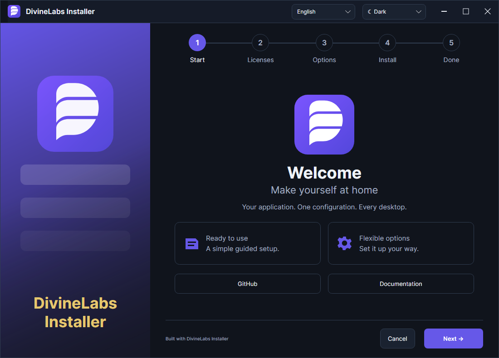

<div align="center">

<h1>DivineLabs Installer</h1>
<p><strong>Your app. Your branding. One config.</strong></p>
<p>Native desktop installers for Windows, macOS and Linux.<br>Avalonia + .NET Native AOT · Open source · MIT</p>

[](https://github.com/TheDivineLabs/DivineLabs_Installer/actions/workflows/build.yml)
[](https://github.com/TheDivineLabs/DivineLabs_Installer/releases)
[](LICENSE)

[Website](https://thedivinelabs.github.io/installer/) · [Download SDK](https://github.com/TheDivineLabs/DivineLabs_Installer/releases/tag/v0.1.1) · [Configuration](docs/configuration.md) · [GitHub Action](docs/github-actions.md) · [Issues](https://github.com/TheDivineLabs/DivineLabs_Installer/issues/new/choose)

**English** · [Русский](README.ru.md) · [Deutsch](docs/i18n/README.de.md) · [Español](docs/i18n/README.es.md) · [简体中文](docs/i18n/README.zh-CN.md)
</div>


<details><summary>Dark theme</summary>



</details>

Package your existing application without integrating another SDK into its code.
Change name, payload, entry point, cover, icon and license in JSON; the same UI handles setup,
updates and removal. The interface follows DivineLabs Idle Slayer's maintenance design.
No game artwork is bundled.

- **Six native targets:** Windows, macOS and Linux; x64 and ARM64.
- **No .NET or WebView installation** on destination machines. Native OS/graphics dependencies still apply.
- **Owned-file transactions:** SHA-256 checks, rollback, interrupted-process recovery and retained user data.
- **Developer tools:** native CLI, editor schema, runnable example and GitHub Action without a .NET toolchain.
- **Interface:** English/Russian, light/dark themes, matching setup and uninstall pages.

Documentation is available in five languages; the interface currently supports **English and Russian**.
This is an early **0.1.x preview**. See delivery limits below before adopting it.

## Download

Choose the SDK for the computer running `divinepack`. Extract it; keep `runtime/` beside the CLI.

| Platform | x64 | ARM64 |
|---|---|---|
| Windows | [SDK ZIP](https://github.com/TheDivineLabs/DivineLabs_Installer/releases/download/v0.1.1/DivineLabs-Installer-win-x64.zip) | [SDK ZIP](https://github.com/TheDivineLabs/DivineLabs_Installer/releases/download/v0.1.1/DivineLabs-Installer-win-arm64.zip) |
| macOS | [SDK TAR.GZ](https://github.com/TheDivineLabs/DivineLabs_Installer/releases/download/v0.1.1/DivineLabs-Installer-osx-x64.tar.gz) | [SDK TAR.GZ](https://github.com/TheDivineLabs/DivineLabs_Installer/releases/download/v0.1.1/DivineLabs-Installer-osx-arm64.tar.gz) |
| Linux | [SDK TAR.GZ](https://github.com/TheDivineLabs/DivineLabs_Installer/releases/download/v0.1.1/DivineLabs-Installer-linux-x64.tar.gz) | [SDK TAR.GZ](https://github.com/TheDivineLabs/DivineLabs_Installer/releases/download/v0.1.1/DivineLabs-Installer-linux-arm64.tar.gz) |

[Release notes and SHA256SUMS.txt](https://github.com/TheDivineLabs/DivineLabs_Installer/releases/tag/v0.1.1).
SDK archives contain the builder; generated installer archives are separate output.

## First installer in three commands

```sh
./divinepack init --dir my-installer
./divinepack validate --config my-installer/installer.json
./divinepack build --config my-installer/installer.json --runtime linux-x64 --output my-output
```

This creates a working demo. In PowerShell use `.\divinepack.exe` and `--runtime win-x64`;
on macOS choose `osx-arm64` or `osx-x64`. Then replace demo files in `application/` and edit
`installer.json`. No C#, Avalonia or .NET SDK is needed.

[Runnable example](examples/hello/installer.json) · [Config reference](docs/configuration.md) · [Troubleshooting](docs/troubleshooting.md)

## Ship from GitHub Actions

```yaml
- uses: TheDivineLabs/DivineLabs_Installer@main
  id: installer
  with:
    config: installer.json
    runtime: win-x64
    sdk-version: v0.1.1
- uses: actions/upload-artifact@v4
  with:
    name: installer
    path: ${{ steps.installer.outputs.archive }}
```

Run after your application's build on a matching runner. Downloads are checked against release checksums.
For reproducible production workflows pin actions to reviewed commit SHAs.
[Copyable workflow](examples/github-actions/build-installer.yml) · [Inputs and runner matrix](docs/github-actions.md)

## Output and integration

| Platform | Output | Default installed location |
|---|---|---|
| Windows | ZIP: native setup EXE, libraries and `.dlpack` payload | `%LOCALAPPDATA%/Programs/<publisher>/<name>` |
| macOS | ZIP containing installer `.app` | `~/Applications/<publisher>/<name>` |
| Linux | TAR.GZ: native setup, libraries and payload | `$XDG_DATA_HOME/<publisher>/<name>` or `~/.local/share/<publisher>/<name>` |

Extract the archive before launching. Keep the native libraries next to the executable.
This version creates **native installer bundles**, not single self-extracting EXEs, MSI,
signed PKG, DEB or RPM packages. Per-product PE resources/macOS bundle icons are not yet
generated; the executable retains DivineLabs identity and UI branding comes from config.

Windows: Installed Apps registration and optional desktop/Start-menu shortcuts. Shortcuts
use the built-in Windows PowerShell/WScript integration. Linux: applications-menu entry,
uninstall action and optional desktop launcher (desktop environments may require user trust).
macOS: user Applications installation; no Dock/desktop shortcut generation in this version.

Maintenance runtime: `.divinelabs-installer/runtime/DivineLabs.Installer` (`.exe` on Windows).
Run it with `--uninstall --dir PATH`. It relocates itself before removing its installed files.
The application payload is **not** duplicated into the maintenance runtime.

## Automation

```sh
divinepack pack --config installer.json --runtime linux-x64 --output application.dlpack
divinepack inspect --package application.dlpack
divinepack install --package application.dlpack --dir ./test-app --no-integrations
divinepack uninstall --dir ./test-app
divinepack uninstall --dir ./test-app --remove-data
```

For GUI maintenance after CLI installation, supply `--runtime-dir` on `install`.
Native setup supports `--silent --dir PATH --no-integrations` and `--uninstall --silent --dir PATH`.
Exit codes: **0** completed, **2** failed, **3** cancelled where cancellation is exposed.
Integration failures are warnings after the file transaction. Silent mode never launches the app.

## Engine behavior

- Streaming archives, SHA-256 and size checks before application-file replacement.
- Stable ownership, refusal to replace foreign files, removal of obsolete owned files on update.
- Journaled file changes, rollback on failure/cancellation, restart recovery after process interruption.
- User data retained by default; retained ownership supports reinstalling later.
- Traversal, duplicate paths, reserved state and symlink/reparse targets are rejected.
- Per-user installation without elevation; no service, driver or system-package installation.

Checksums detect corruption; they **do not authenticate publishers**. Distributors sign their
own platform artifacts. This release has no trusted online update feed or automatic update
delivery. Packages containing symlinks, including some macOS framework bundles, are rejected.
Process-interruption recovery is tested; power-loss durability and hostile concurrent filesystem
mutation are not claimed. The toolkit is a starting release, not production acceptance for
arbitrary applications or every Linux distribution.

## Build and verify

Use `global.json`'s SDK and the native compiler: Windows MSVC/SDK, macOS Xcode CLI tools,
or Linux clang/zlib development packages. Native AOT builds run on their target OS.

```sh
dotnet build DivineLabs.Installer.slnx -c Release
dotnet run --project tests/DivineLabs.Installer.Tests -c Release
pwsh ./scripts/publish.ps1 -Runtime linux-x64 -Output ./artifacts/sdk-linux-x64
pwsh ./scripts/smoke-native.ps1 -Sdk ./artifacts/sdk-linux-x64
dotnet run --project tests/DivineLabs.Installer.Visuals -c Release -- artifacts/screenshots
```

CI covers six OS/CPU targets: contracts, Native AOT SDK publication, configuration-driven
bundle construction, installation and the **installed** uninstaller, including data retention.
Windows renders setup and uninstall pages in both themes/languages without opening a desktop window.

`Core` contains portable contracts/transactions; `Platforms` implements system integration;
`Desktop` is the Avalonia shell; `Cli` is the native `divinepack` builder.
See [CONTRIBUTING.md](CONTRIBUTING.md), [NOTICE.md](NOTICE.md) and the [roadmap](docs/ROADMAP.md).
