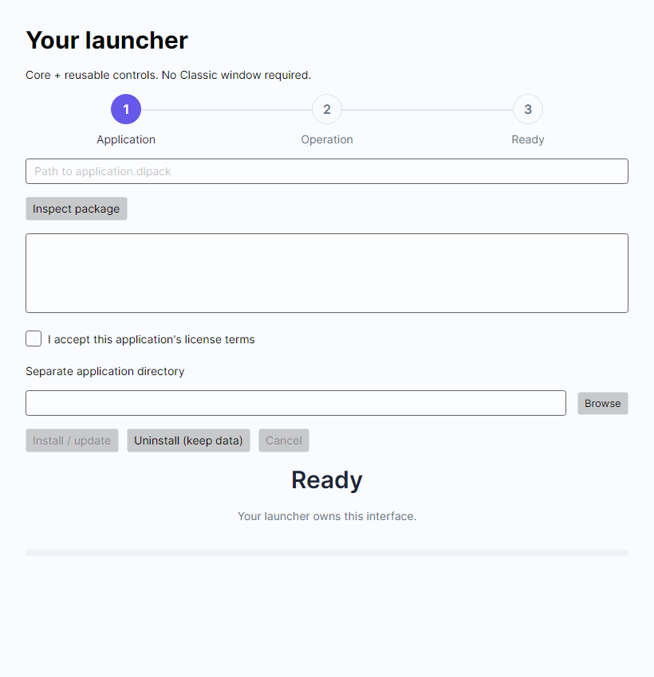

# Embed the installer

[Home](../README.md) · [Architecture](architecture.md) · [API](api.md) · [Runnable custom launcher](../examples/embedded-launcher/) · [Runnable Classic host](../examples/classic-host/)

## Get the libraries

Download the four `.nupkg` files from [0.2.1 Preview](https://github.com/TheDivineLabs/DivineLabs_Installer/releases/tag/v0.2.1)
into one local NuGet feed. These are actual .NET 10 libraries; they are not published to nuget.org in this preview.
Alternatively build the feed from this repository:

```sh
pwsh ./scripts/pack-libraries.ps1 -Output ./artifacts/libraries
```

In your project directory:

```sh
dotnet nuget add source /absolute/path/to/libraries --name DivineLabsLocal --configfile NuGet.Config
dotnet add package DivineLabs.Installer.Core --version 0.2.1
dotnet add package DivineLabs.Installer.Platforms --version 0.2.1
# Optional for Avalonia hosts:
dotnet add package DivineLabs.Installer.Components --version 0.2.1
# Optional complete template:
dotnet add package DivineLabs.Installer.Templates.Classic --version 0.2.1
```

Create a project-local `NuGet.Config` first if your project does not have one:

```xml
<configuration>
  <packageSources>
    <add key="nuget.org" value="https://api.nuget.org/v3/index.json" />
  </packageSources>
</configuration>
```

Keep nuget.org enabled for Avalonia dependencies. Then run the source/package commands above.
The same packages can be referenced through normal `<PackageReference>` items. Config-only SDK users still need no .NET toolchain.

## Your own launcher

```csharp
using DivineLabs.Installer.Core;
using DivineLabs.Installer.Platforms;

IInstallerEngine engine = new Engine(new PlatformServices());
using var cancel = new CancellationTokenSource();
// Construct on your UI thread. Progress<T> dispatches reports through its captured context.
var progress = new Progress<InstallProgress>(p => {
    // Update your existing UI or the Components controls here.
});
var result = await engine.InstallAsync(
    new InstallRequest("application.dlpack", applicationDirectory, Options: new InstallOptions(false)),
    progress, cancel.Token);
// Display result.Warnings. The launcher owns maintenance and data-removal confirmation.
await engine.UninstallAsync(new UninstallRequest(applicationDirectory), progress, cancel.Token);
```

The last line demonstrates a separate uninstall action; do not place it immediately after install in a real product.
This example disables OS registration because the launcher owns maintenance. Stop using the application before
replacing its files. Do not target the running launcher's own directory; self-update needs a separate helper.
No application is launched automatically.

Try the complete application:

```sh
# First produce application.dlpack with divinepack pack.
dotnet run --project examples/embedded-launcher -- /path/to/application.dlpack /path/to/separate-app
```

The sample inspects the package, displays its license, requires acceptance, installs/updates, reports progress,
cancels with rollback and removes owned files while retaining data. It uses three libraries and its own screen.

## Reusable Avalonia controls

```xml
<StackPanel xmlns="https://github.com/avaloniaui"
            xmlns:installer="clr-namespace:DivineLabs.Installer.Components;assembly=DivineLabs.Installer.Components">
  <installer:DirectoryPicker DirectoryPath="{Binding InstallDirectory, Mode=TwoWay}" />
  <installer:OperationProgressView Title="Installing" Percent="{Binding Percent}" Detail="{Binding Detail}" />
</StackPanel>
```

Supply a data context/compiled binding types using your normal Avalonia app conventions.
`StepIndicator.Labels` and `ActiveIndex` display host-defined steps. All three controls expose styled properties;
they install nothing, create no window and add no global theme. The host supplies its normal control theme.
Brush properties on progress/step controls allow custom colors; folder picking uses the hosting top-level's storage provider.



## DivineLabs Classic

```csharp
using DivineLabs.Installer.Templates.Classic;

using var session = ClassicSession.OpenPackage(packagePath, engine, platform,
    targetDirectory: applicationDirectory);
var window = new ClassicWindow(session);
await window.ShowDialog(ownerWindow);
```

Keep `session` alive until the window closes. For a standalone maintenance runtime pass `runtimeDirectory`
and `options: new InstallOptions()` explicitly; the host owns validating/publishing that runtime.
Embedded sessions disable integrations by default. The stock Desktop host enables them and supplies its matching runtime.
For removal, await `ClassicSession.OpenInstallationAsync(applicationDirectory, engine, platform)` and open another Classic window.
Classic scopes resources/styles to its own window. It does not replace your app's theme or application lifetime.

The minimal [Classic host project](../examples/classic-host/) compiles this integration without referencing Desktop.
The full Desktop executable additionally handles relocating the maintenance runtime before deleting itself.
Publish your .NET host with Native AOT and the appropriate OS compiler when distributing without a .NET runtime.
Keep MIT/third-party notices from [NOTICE.md](../NOTICE.md) in your application's release process.
