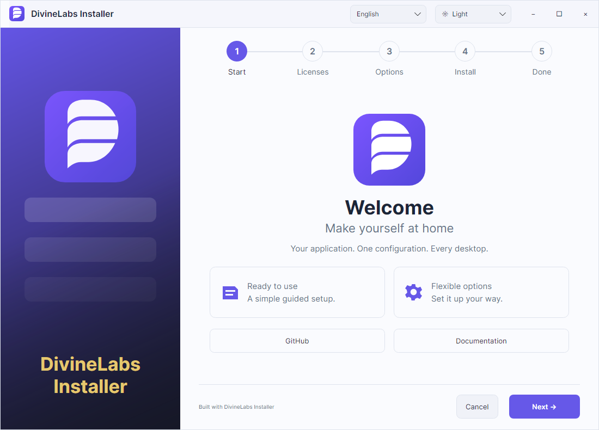

# DivineLabs Installer

**你的应用，你的设计，一个配置文件。**

[English](../../README.md) · [Русский](../../README.ru.md) · [Deutsch](README.de.md) · [Español](README.es.md) · [简体中文](README.zh-CN.md)

面向 Windows、macOS 和 Linux 的原生安装工具，支持 x64 和 ARM64。基于 Avalonia 和 .NET Native AOT，采用 MIT 许可证。

[SDK 0.2.0 Preview](https://github.com/TheDivineLabs/DivineLabs_Installer/releases/tag/v0.2.0) · [Website](https://thedivinelabs.github.io/installer/) · [GitHub](https://github.com/TheDivineLabs/DivineLabs_Installer)



## 快速开始

下载并解压适合当前平台的 SDK，保留 `divinepack` 旁边的 `runtime/` 目录。以下命令会生成可用的示例安装包。然后替换 `application/` 中的文件并修改 `installer.json`。Windows 使用 `.\divinepack.exe` 和 `win-x64`；macOS 使用 `osx-arm64` 或 `osx-x64`。

```sh
./divinepack init --dir my-installer
./divinepack validate --config my-installer/installer.json
./divinepack build --config my-installer/installer.json --runtime linux-x64 --output my-output
```

## 配置与自动化

应用无需使用 C#、Avalonia，也无需集成额外的 SDK。文件路径相对于配置文件解析，`entryPoint` 相对于 `source`。更新时保持产品 `id` 和数据目录定义不变。`dataDirectories` 默认保留，不应包含随应用分发的文件。

- [JSON configuration (English)](../configuration.md)
- [Hello example](../../examples/hello/installer.json)
- [GitHub Action (English)](../github-actions.md) · [Workflow](../../examples/github-actions/build-installer.yml)
- [Troubleshooting (English)](../troubleshooting.md)
- [Contributing (English)](../../CONTRIBUTING.md) · [Roadmap (English)](../ROADMAP.md)

## 预览版限制

目前界面支持英语和俄语，以及浅色和深色主题。文档翻译不代表界面支持相同语言。运行前必须解压生成的安装包。本预览版不生成单文件自解压 EXE、MSI、PKG、DEB 或 RPM，不提供自动更新分发或内置签名。符号链接会被拒绝，系统原生图形依赖仍然需要满足。

[MIT](../../LICENSE) · [Third-party notices](../../NOTICE.md)

## 引擎与自定义界面

Core 提供 `IInstallerEngine`，Platforms 提供可选的系统集成，Components 提供可复用的 Avalonia 控件，Templates.Classic 提供完整的默认设计。四个 .NET 10 库以 `.nupkg` 文件分发，目前未发布到 nuget.org。[嵌入指南（英文）](../embedding.md) · [API（英文）](../api.md)。
